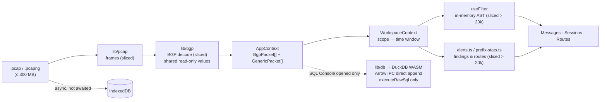

# Working on BGPShark

Quick orientation and invariants for contributors and AI agents working in this repository.

- Product overview: [`README.md`](README.md) ([日本語](README.ja.md))
- Architecture diagrams (load pipeline, filtering, findings, CI): [`docs/architecture.md`](docs/architecture.md) ([日本語](docs/architecture.ja.md))
- Specifications & performance targets: [`docs/design.md`](docs/design.md)
- DuckDB WASM ADR: [`docs/design-duckdb-wasm.md`](docs/design-duckdb-wasm.md)
- Fault-coverage matrix (14 scenarios): [`docs/troubleshooting-scenarios.md`](docs/troubleshooting-scenarios.md)

## Architecture at a Glance



## Commands

```bash
bun install
bun run dev          # Dev server at http://localhost:5173/bgpshark/ (NO CSP)
bun test             # Unit tests under tests/lib and tests/testlab
bun run test:e2e     # Playwright e2e suite under tests/e2e (Chromium + DuckDB WASM)
E2E_PREVIEW=1 bun run test:e2e  # Same suite against the production build, with the real CSP (what CI runs)
bun run lint         # ESLint
bun run build        # Type-check (src, tests, testlab) + production build to dist/
bun run preview      # Serve production build (with real CSP) at http://localhost:4173/bgpshark/
bun run pcap <preset|file.ts> --dump  # Build a one-off capture into testlab/out/ and list how the app decodes it
bun run screenshots  # Regenerate manual screenshots in public/manual/
bun run og-image     # Regenerate the link-preview card public/og-image.png (uses public/manual/workspace.png)
```

In environments where Playwright cannot download its pinned browser or a system Chromium/Chrome binary is preinstalled, pass `CHROMIUM_PATH` to skip the revision lookup:

```bash
CHROMIUM_PATH=/path/to/chromium bun run test:e2e
```

For large-capture memory/long-task benchmarking (300 MB ceiling), see [`testlab/README.md`](testlab/README.md) (`testlab/large-captures.ts`, `testlab/measure-large.ts`, `testlab/measure-pipeline.ts`).

## Critical invariants

- **Strict production CSP & zero third-party requests:**
  - `vite.config.ts` injects the Content Security Policy at **build time only**—the dev server ships no CSP.
  - Production forbids all off-origin fetches (`connect-src 'self' blob: data:`) and forbids dynamic code evaluation (`script-src 'self' 'wasm-unsafe-eval'`, no `eval` or `new Function`).
  - Never use DuckDB features that download remote extensions (e.g. `read_json_auto`) or libraries that rely on `new Function` (e.g. `apache-arrow` high-level builders—`src/lib/db/loader.ts` constructs Arrow IPC buffers manually for this reason).
  - Whenever touching asset loading, DuckDB queries, or dependencies, verify with `bun run build && bun run preview` and `tests/e2e/offline.e2e.ts`.
- **Decoded messages are read-only:** `src/lib/bgp/shared-decode.ts` deduplicates path attribute blocks, attributes, and prefixes across messages, and `src/lib/pcap/shared-values.ts` shares frame-level values. Never mutate a decoded `BgpPacket`, `BgpMessage`, attribute, or `BgpPrefix`.
- **One filter backend, in memory:** Filter expressions are parsed once into an AST and evaluated in memory (`src/lib/filter/parser.ts`); above `SYNC_FILTER_MAX_PACKETS` the pass is debounced and run in slices (`src/hooks/useFilter.ts`). `!=` and `not contains` are the complement of `=` and `contains`, so `prefix != 10.0.0.0/8` includes OPENs and KEEPALIVEs (pinned by `tests/e2e/prefix-matching.e2e.ts`).
- **DuckDB serves only the SQL Console:** It is not started at page load. The SQL Console asks for the capture when it opens (`requestDatabase` in `src/hooks/useBgpAnalyzer.ts`), and `src/lib/db/queries.ts` exposes only `executeRawSql`. Tables live in a compressed in-memory catalog (`capture`) with no primary keys or secondary indexes (`src/lib/db/database.ts`, `schema.ts`).
  - Chunks are appended straight from Arrow IPC, which binds columns by **position**: column order in `src/lib/db/load-batches.ts` must match `SCHEMA_SQL` (checked at load time by `checkColumnOrder` and by `tests/lib/db/load-batches.test.ts`).
- **Per-session route accounting:** Route flaps and AS_PATH changes are tracked per session `(sender, receiver)`—not per sender—so route servers and route reflectors do not trigger false positives (`src/lib/bgp/prefix-stats.ts` packs state at 2 bits per route). Keep `prefix-stats.ts`, `alerts.ts`, and the SQL Console's *Prefix Flapping* template (`src/pages/SqlConsolePage.tsx`) in agreement.
- **One body for sync & sliced execution:** Heavy loops (parsing, filtering, prefix stats, alert rules, large route sorting) are written as generators driven by `src/lib/sliced.ts` (`runToEnd` below threshold, `runInSlices` ~12 ms slices above it) so unit tests and large captures execute identical logic.
- **Alert rules are specified:** [`docs/design.md`](docs/design.md) §2.1.14 defines every rule's trigger conditions and required false-positive exclusions. When adding or modifying an alert rule, update that table and test against the 14-scenario corpus in `testlab/scenarios.ts` (see [`docs/troubleshooting-scenarios.md`](docs/troubleshooting-scenarios.md)).
- **Manual prose, screenshots & bilingual docs:**
  - The user manual (`src/pages/manual/manual.md` and `manual.ja.md`) is converted to HTML at build time by `markdownPlugin` in `vite.config.ts`. Edit the Markdown files, not `ManualPage.tsx`.
  - Keep `h2`/`h3` anchor IDs strictly synchronized between English and Japanese (Japanese headings use explicit `{#id}` suffixes; enforced by `tests/e2e/manual.e2e.ts`).
  - Manual screenshots (`public/manual/*.png`) are committed. Re-run `bun run screenshots` after changing any UI referenced by the manual and commit updated images.
  - When updating architecture flows, update both `docs/architecture.md` and `docs/architecture.ja.md`.

## Key thresholds

| Constant | Value | Location | Purpose |
|----------|-------|----------|---------|
| `MAX_FILE_SIZE` | 300 MB | `src/lib/file-constraints.ts` | Keeps JS heap < 3 GB (1 GB spare in 4 GB tab) on worst-case shapes |
| `BGP_MAX_MESSAGE_LENGTH` | 4,096 B | `src/lib/bgp/parser.ts` | Per-flow TCP reassembly cap (overflow → desync warning) |
| `SYNC_FILTER_MAX_PACKETS` | 20,000 | `src/hooks/useFilter.ts` | Above this: 200 ms debounce + ~12 ms sliced filter |
| `BACKGROUND_FINDINGS_MIN_PACKETS` | 20,000 | `src/context/WorkspaceContext.tsx` | Above this: `prefixStatsForAsync` + `alertsForAsync` in ~12 ms slices |
| `SYNC_SORT_MAX_ROUTES` | 50,000 | `src/pages/RoutesPage.tsx` | Above this: show capture order while `sortWork` runs in slices |
| `ROWS_PER_FLUSH` | 250,000 | `src/lib/db/loader.ts` | Cross-table row batch size for pipelined Arrow IPC appends |

## Change → Verify quick map

| When you change… | Verify with… |
|------------------|--------------|
| Asset loading, DuckDB, CSP, or dependencies | `E2E_PREVIEW=1 bun run test:e2e tests/e2e/offline.e2e.ts` (or `bun run build && bun run preview`) |
| `src/lib/db/schema.ts` or `load-batches.ts` | `bun test tests/lib/db/` + `tests/e2e/sql-console.e2e.ts` |
| Filter fields, parser, or operators | `bun test tests/lib/filter/` + `tests/e2e/prefix-matching.e2e.ts` + `tests/e2e/filter-input.e2e.ts` |
| BGP decoding or `src/lib/build` encoding | `bun test tests/lib/bgp/ tests/lib/build/` (includes `round-trip.test.ts`) |
| Alert rules or findings | Update `docs/design.md` §2.1.14, run `bun test tests/lib/dashboard/` + `tests/e2e/findings.e2e.ts` + scenario checks |
| Route flap / AS_PATH counting | `bun test tests/lib/bgp/prefix-stats.test.ts` + `tests/e2e/route-server.e2e.ts` + SQL *Prefix Flapping* template |
| Manual prose or UI shown in manual | Sync EN/JA `{#id}` headings, `bun run screenshots`, `tests/e2e/manual.e2e.ts` |
| Large-capture memory or hot loops | `testlab/large-captures.ts` + `testlab/measure-large.ts` (production build) |

## Testing & conventions

- **Tests mirror source:** Unit tests live in `tests/lib/**` and `tests/testlab/**` (`bun test`). Browser specs live in `tests/e2e/*.e2e.ts` (named `.e2e.ts` so `bun test` does not execute them). See `tests/e2e/helpers.ts` for shared capture-loading helpers.
- **Build test fixtures in code:** Generate captures using `src/lib/build` or `bun run testlab/scenarios.ts` rather than committing opaque binary pcaps.
  - For a one-off capture (checking a fix by hand, reproducing a report), write a capture file and run `bun run pcap <file> --dump` instead of a script that imports the builder and writes bytes itself. `bun run pcap --new <file>` writes a starter; see `testlab/README.md` for what a capture file may export. Raw bytes, non-BGP packets and edits to existing captures (dropped frames, time jumps, damaged bytes, lying record headers) are covered there too — reach for those before hand-assembling frames.
- **Type-checking covers scripts:** `tsconfig.json` includes `src`, `tests`, and `testlab`, so `bun run build` validates test and lab scripts too.
- **Comments explain *why*:** Preserve and match the codebase's existing docblocks explaining module rationale and prevented failure modes.
- **UI navigation notes for debugging:**
  - **Capability Diff** appears on the **Sessions** tab once a session is chosen (in the workspace's left column or the tab's own table); with none chosen the tab is a table of sessions.
  - **Filter errors** render in a red row directly under the filter box (`data-testid="filter-error"`), in the UI language, and leave the list unfiltered.
  - **TCP-level frames** (`SYN`, `RST`, `FIN`) appear only when the packet list is switched to **All Packets**.

## Git

Branch, commit, and push as instructed for the session. Do not open a pull request unless asked.

Releases: add the version's section to `CHANGELOG.md` and bump `package.json` in a pull request; after it merges, push the tag `v<version>` on that `main` commit. `.github/workflows/release.yml` refuses a tag that does not match `package.json`.
