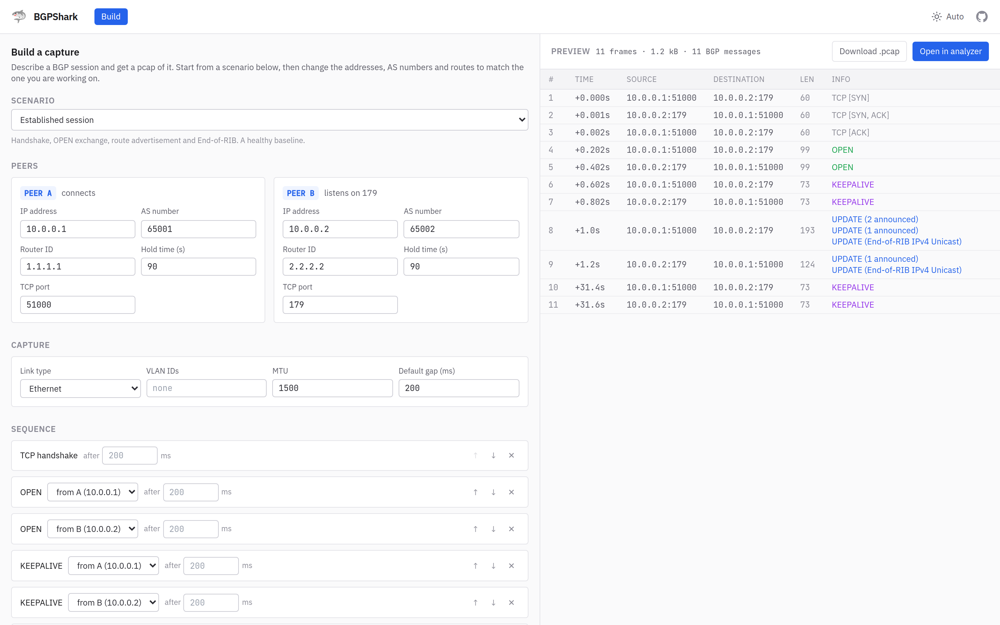
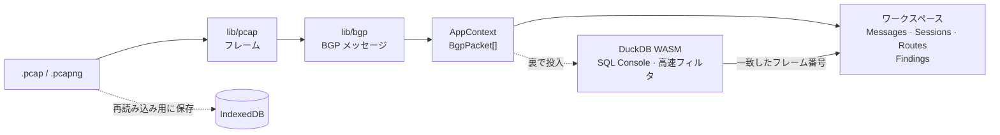

# 🦈 BGPShark

[English](README.md) | 日本語

BGP セッションのトラブルシューティングに特化した、ブラウザ完結型の pcap アナライザーです。
Wireshark を起動することなく、OPEN・UPDATE・NOTIFICATION・KEEPALIVE・ROUTE-REFRESH メッセージをブラウザ上で素早く解析できます。

**すべての処理はブラウザ内で完結します** — キャプチャファイルが外部サーバーにアップロードされることはありません。

## 主な機能

- **pcap / pcapng 対応** — `.pcap` / `.pcapng` / `.cap`（最大 100 MB）を自動判別。Ethernet および Linux SLL リンクタイプに対応し、802.1Q / QinQ タグの除去、TCP セグメントの再構成、IPv4 / IPv6 トランスポート、非標準ポート上の BGP 検出を行います。
- **完全な BGP デコード** — OPEN ケイパビリティ、UPDATE パス属性（AS_PATH、コミュニティ、Large / Extended コミュニティ、IPv6 NLRI を含む MP_REACH / MP_UNREACH、ADD-PATH）、NOTIFICATION のエラーコード・data フィールド解析とトラブルシューティングヒント、Hold Timer 満了時の無応答時間分析、ROUTE-REFRESH の前後差分表示に対応しています。
- **EVPN デコード** — MAC/IP Advertisement および Inclusive Multicast ルート（RD・MAC・VNI・ESI）をデコードし、その他の EVPN ルートタイプも識別します。
- **調査ワークスペース** — すべての画面の左側に、セッション一覧と検出事項を表示します。検出事項は種類ごとにまとめます（3 セッションでの 1 回の Hard Reset は、16 行ではなく 1 件として表示します）。セッションを選ぶと、すべての画面がそのセッションに絞られます。
- **Message Explorer** — パケット一覧、階層化された詳細ビュー、16 進ダンプ、フィルタ適用後の `.pcap` エクスポートを備えています。
- **Sessions** — セッション（アドレスの組）ごとに、キャプチャ終了時点の状態を一覧表示します。セッションを選ぶと、OPEN とケイパビリティの並列比較（Capability Diff）、ADD-PATH のネゴシエーション結果、方向別の経路数、OPEN と NOTIFICATION の出来事を表示します。
- **Route Analysis** — プレフィックスごとの広告・取り消し（Withdraw）履歴、フラップ回数、ベストパス選択に関わる属性（AS_PATH・Next Hop・MED・LOCAL_PREF・コミュニティ）を確認できます。
- **SQL Console** — ブラウザ上の DuckDB WASM を使ってキャプチャを SQL で直接クエリできます。
- **フィルタ式** — Wireshark 風の検索ボックス（例：`type = NOTIFICATION and ip = 10.0.0.1` や単純な `10.0.0.1`）で、入力補完・メニュー形式の **+ Filter**・パケット詳細からのワンクリックフィルタ適用・CIDR を考慮したプレフィックス照合に対応しています。詳細はアプリ内マニュアル（[`src/pages/manual/manual.ja.md`](src/pages/manual/manual.ja.md)）を参照してください。
- **Capture Builder** — プリセットや任意のピア・メッセージ手順から、検証用の BGP `.pcap` ファイルをブラウザ上で生成できます。
- **アプリ内ユーザーマニュアル** — `/manual` で英語・日本語のマニュアルを閲覧できます。各画面の使い方、フィルタ構文、症状別のトラブルシューティング手順を収録しています。
- **ライト / ダークテーマ**（OS 設定に追従）および **IndexedDB による永続化**（リロードしても読み込んだキャプチャを保持）。

## クイックスタート

動作には [Bun](https://bun.sh/) が必要です。

```bash
bun install
bun run dev        # http://localhost:5173/bgpshark/
```

### 主なスクリプト

```bash
bun test           # ユニットテストを実行 (tests/lib)
bun run test:e2e   # Chromium 上で Playwright E2E テストを実行 (tests/e2e)
bun run build      # 型チェックおよび dist/ への本番ビルド
bun run preview    # 本番ビルドをローカルで配信
bun run lint       # ESLint を実行
```

### E2E テストの実行

初回のみ Playwright の Chromium をインストールし、テストを実行します。

```bash
bunx playwright install chromium
bun run test:e2e
```

オフライン環境やシステムにインストール済みの Chromium を使う場合は、`CHROMIUM_PATH` を指定するとブラウザの自動検索をスキップできます。

```bash
CHROMIUM_PATH=/usr/bin/chromium bun run test:e2e
```

CI では開発サーバーではなく本番ビルドに対して E2E テストを実行し、実際の Content Security Policy（CSP）下での動作を検証しています。ローカルでも同じ条件で実行するには以下を使います（自動的にビルドしてから実行します）。

```bash
E2E_PREVIEW=1 bun run test:e2e
```

> [!NOTE]
> 開発サーバーには本番用の Content Security Policy が適用されません。アセット読み込み・WASM・依存ライブラリに関わる変更を行った後は、`bun run build && bun run preview` または `E2E_PREVIEW=1 bun run test:e2e` で本番ビルドを確認してください。

### Nix 開発シェル

`flake.nix` により、Bun・Node および設定済みの Playwright ブラウザ（Linux 環境）が揃った開発シェルを利用できます。

```bash
nix develop        # または `direnv allow`
bun install
bun run dev
bun run test:e2e   # `playwright install` は不要
```

`package.json` の `@playwright/test` を更新する際は、`flake.nix` の nixpkgs リビジョンも同じ Playwright ドライバーバージョンに揃えてください（`nix eval github:NixOS/nixpkgs/<rev>#playwright-driver.version` で確認できます）。

## Capture Builder

**Build** 画面（`/builder`）では、ラボ環境を用意せずに有効な BGP キャプチャを生成できます。8 種類のプリセット（正常確立、Hold Timer 満了、AS 不一致、TCP 接続拒否、IPv6 トランスポート、経路フラップ、4 バイト AS、TCP セグメント分割された UPDATE）から選び、ピア情報・経路・メッセージ手順を編集してプレビュー確認や `.pcap` のダウンロードが可能です。



UPDATE のエンコーディング（4 バイト AS 幅や ADD-PATH Path Identifier）は OPEN のケイパビリティ設定から自動で決定され、TCP セグメント分割は MTU 設定に従います。IPv4 / TCP チェックサムも正しく計算されるため、出力したファイルは Wireshark など他のツールでもそのまま開けます。同じ生成機能は `src/lib/build` からライブラリとしても利用できます。

## アーキテクチャ



処理はすべてブラウザのタブ内で行います。デコードが終わるとすぐにパケット一覧を表示し、DuckDB への投入はその後に行います。DuckDB は「どのフレームが一致するか」だけを返すため、DuckDB がなくても SQL Console 以外の画面はすべて使えます。フィルタ式は一度だけ構文木に変換し、DuckDB WASM 上の SQL かメモリ上の評価のどちらかで実行します。

読み込みの流れ、デコードの階層、状態遷移、フィルタの 2 方式、DuckDB のテーブル、Findings の算出、画面構成、Capture Builder、CI の図は **[docs/architecture.ja.md](docs/architecture.ja.md)** にまとめています。

| パス | 役割 |
|------|------|
| `src/lib/pcap/` | pcap / pcapng パーサー、pcap ライター、IPv6 および非標準ポート検出 |
| `src/lib/bgp/` | BGP メッセージ・パス属性パーサー、エラーヒント、セッション・プレフィックス解析 |
| `src/lib/build/` | BGP エンコーダー、TCP/IP/Ethernet フレーミング、シナリオビルダーとプリセット |
| `src/lib/db/` | DuckDB WASM 初期化、スキーマ、Arrow IPC ローダー、クエリ API、フィルタ→SQL 変換 |
| `src/lib/filter/` | フィルタ式の字句解析・構文解析・インメモリ評価 |
| `src/lib/net/` | プレフィックス解析および CIDR 包含判定 |
| `src/pages/` | 各画面のページコンポーネントおよびアプリ内マニュアル（`manual/manual.md`, `manual/manual.ja.md`） |
| `src/components/` | UI コンポーネント（`builder/`, `common/`, `dashboard/`, `layout/`, `message/`, `neighbor/`, `workspace/`） |
| `src/context/` | アプリ全体の状態（読み込んだキャプチャ、ワークスペースのセッション・検出結果・選択状態） |
| `src/hooks/` | 解析・フィルタ・テーマ・分割ペイン・列設定などの React フック |
| `src/i18n/` | UI 文言と NOTIFICATION の日本語ヒント |
| `testlab/` | ContainerLab トポロジ、障害シナリオ生成スクリプト（`scenarios.ts`）、スクリーンショット生成 |
| `docs/` | アーキテクチャ図、技術設計書、DuckDB の設計判断記録、トラブルシューティングシナリオ評価 |

## ドキュメントとテストラボ

- [docs/architecture.ja.md](docs/architecture.ja.md) — アーキテクチャ図: モジュール構成、読み込みの流れ、フィルタ、Findings、CI
- [docs/design.md](docs/design.md) — 要件定義、アラート仕様、技術設計書（英語）
- [docs/troubleshooting-scenarios.md](docs/troubleshooting-scenarios.md) — 14 の BGP 障害シナリオと対応状況マップ（英語）
- [docs/design-duckdb-wasm.md](docs/design-duckdb-wasm.md) — DuckDB WASM 採用の経緯と設計判断（英語）
- [testlab/README.md](testlab/README.md) — ContainerLab トポロジ、合成シナリオ生成、マニュアル用スクリーンショット生成手順（英語）

## デプロイ

Pull Request では `.github/workflows/ci.yml` により lint・ユニットテスト・ビルド・E2E テストが実行されます。`main` へのプッシュでは同じ検証ののち、`.github/workflows/deploy.yml` によって GitHub Pages（`/bgpshark/`）へデプロイされます。

## プライバシー

BGPShark はサードパーティへのネットワーク通信を一切行いません。キャプチャはブラウザ内で解析され IndexedDB にのみ保存されます。DuckDB WASM ランタイムはセルフホストされており、本番ビルドではすべての通信を同一オリジンに制限する厳格な Content Security Policy が適用されます。

## サードパーティライセンス

バンドルされているフォントおよびサードパーティライブラリのライセンス表記は [`public/THIRD-PARTY-LICENSES.txt`](public/THIRD-PARTY-LICENSES.txt) にまとめており、アプリの開始画面およびユーザーマニュアル下部からも参照できます。
