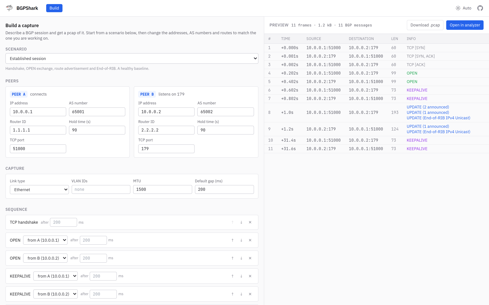
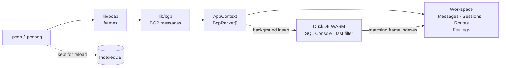

# 🦈 BGPShark

English | [日本語](README.ja.md)

A browser-based pcap analyzer specialized for BGP session troubleshooting.
Inspect OPEN, UPDATE, NOTIFICATION, KEEPALIVE, and ROUTE-REFRESH messages without launching Wireshark.

**Everything runs locally in the browser** — capture files are never uploaded to a server.

## Features

- **pcap / pcapng support** — Auto-detected (`.pcap`, `.pcapng`, `.cap` up to 100 MB). Handles Ethernet and Linux SLL link types, strips 802.1Q / QinQ tags, reassembles TCP segments, and supports IPv4/IPv6 transport as well as BGP on non-standard ports.
- **Full BGP decoding** — OPEN capabilities, UPDATE path attributes (AS_PATH, communities, large/extended communities, MP_REACH/MP_UNREACH including IPv6 NLRI, ADD-PATH), NOTIFICATION error codes with decoded data fields and troubleshooting hints, Hold Timer silence analysis, and ROUTE-REFRESH diffs.
- **EVPN decoding** — Decodes MAC/IP Advertisement and Inclusive Multicast routes (RD, MAC, VNI, ESI) and identifies other EVPN route types.
- **Investigation workspace** — Every view shares a sessions list and a findings list that folds alerts by kind (one hard reset across three sessions is one finding, not sixteen rows). Pick a session to narrow every view to it.
- **Message Explorer** — Packet list, hierarchical message detail, hex dump, and filtered pcap export.
- **Sessions** — Every session (address pair) with its end-of-capture state; choose one for a side-by-side OPEN / capability diff, ADD-PATH negotiation results, per-direction prefix counts, and its OPEN/NOTIFICATION events.
- **Route Analysis** — Per-prefix announce/withdraw history, flap counts, and best-path attributes (AS_PATH, Next Hop, MED, LOCAL_PREF, communities).
- **SQL Console** — Query the capture directly in the browser with DuckDB WASM.
- **Filter expressions** — one Wireshark-style query box (e.g. `type = NOTIFICATION and ip = 10.0.0.1`, or just `10.0.0.1`) with autocomplete, a menu-driven **+ Filter**, and apply-as-filter from packet details and CIDR-aware prefix matching. See the in-app manual ([`src/pages/manual/manual.md`](src/pages/manual/manual.md)) for the full filter reference.
- **Capture Builder** — Generate realistic BGP pcap files directly in the browser from presets or custom peer/message sequences.
- **In-app User Manual** — Available at `/manual` in English and Japanese, covering every screen, the filter language, and symptom-based troubleshooting walkthroughs.
- **Light / dark theme** and **IndexedDB persistence** across reloads.

## Getting started

Requires [Bun](https://bun.sh/).

```bash
bun install
bun run dev        # http://localhost:5173/bgpshark/
```

### Scripts

```bash
bun test           # Run unit tests (tests/lib)
bun run test:e2e   # Run Playwright end-to-end tests in Chromium (tests/e2e)
bun run build      # Type-check and build to dist/
bun run preview    # Serve the production build locally
bun run lint       # Run ESLint
```

### Running end-to-end tests

Install Playwright's Chromium binary once, then run the suite:

```bash
bunx playwright install chromium
bun run test:e2e
```

In offline environments or when using a system Chromium, set `CHROMIUM_PATH` to skip Playwright's browser lookup:

```bash
CHROMIUM_PATH=/usr/bin/chromium bun run test:e2e
```

CI runs the suite against the production build instead of the dev server, so the real Content Security Policy is in force. To do the same locally (it builds first):

```bash
E2E_PREVIEW=1 bun run test:e2e
```

> [!NOTE]
> The dev server does not apply the production Content Security Policy. After changes that affect asset loading, WASM, or dependencies, verify the built app with `bun run build && bun run preview`, or run the e2e suite with `E2E_PREVIEW=1`.

### Nix development shell

`flake.nix` provides a dev shell with Bun, Node, and pre-configured Playwright browsers (on Linux):

```bash
nix develop        # or `direnv allow`
bun install
bun run dev
bun run test:e2e   # no `playwright install` step required
```

When upgrading `@playwright/test` in `package.json`, keep the nixpkgs revision in `flake.nix` aligned with the same Playwright driver version (`nix eval github:NixOS/nixpkgs/<rev>#playwright-driver.version`).

## Capture builder

The **Build** screen (`/builder`) lets you synthesize valid BGP captures without a lab. Choose one of the eight presets (established session, hold timer expiry, bad peer AS, refused TCP connection, IPv6 transport, route flap, 4-byte AS, segmented UPDATEs), adjust peers, routes, and message steps, and preview or download the resulting `.pcap` file.



UPDATE encoding (4-byte AS width, ADD-PATH Path Identifiers) is derived automatically from the OPEN capabilities, and TCP segmentation follows the configured MTU. All IPv4/TCP checksums are computed properly, so exported captures work in Wireshark and other tools. The same generator is also available programmatically via `src/lib/build`.

## Architecture



Everything runs in the browser tab. The packet list appears as soon as decoding finishes; DuckDB is filled afterwards and only ever answers *which frames* match, so every screen except the SQL Console keeps working without it. Filter expressions parse once into an AST and run either against DuckDB WASM or in memory.

**See [docs/architecture.md](docs/architecture.md)** for diagrams of the load pipeline, decoding layers, state machines, filter backends, DuckDB tables, findings pipeline, routes, Capture Builder and CI.

| Path | Contents |
|------|----------|
| `src/lib/pcap/` | pcap and pcapng parsers, pcap writer, IPv6 & non-standard port detection |
| `src/lib/bgp/` | BGP message and path attribute parsers, error hints, session & prefix analysis |
| `src/lib/build/` | BGP message encoders, TCP/IP/Ethernet framing, scenario builder & presets |
| `src/lib/db/` | DuckDB WASM setup, schema, Arrow IPC loader, query API, filter-to-SQL compiler |
| `src/lib/filter/` | Filter expression lexer, parser, and in-memory evaluator |
| `src/lib/net/` | Prefix parsing and CIDR containment arithmetic |
| `src/pages/` | Page components and the in-app manual (`manual/manual.md`, `manual/manual.ja.md`) |
| `src/components/` | UI components (`builder/`, `common/`, `dashboard/`, `layout/`, `message/`, `neighbor/`, `workspace/`) |
| `src/context/` | App-wide state: the loaded capture, and the workspace's sessions, findings and selection |
| `src/hooks/` | React hooks for analysis, filtering, theme, split panes, and column settings |
| `src/i18n/` | UI strings and Japanese NOTIFICATION hints |
| `testlab/` | ContainerLab topology, fault scenario generator (`scenarios.ts`), screenshot script |
| `docs/` | Architecture diagrams, technical design, DuckDB decision record, troubleshooting scenario assessment |

## Documentation & test lab

- [docs/architecture.md](docs/architecture.md) — Architecture diagrams: module layers, load pipeline, filtering, findings, CI ([日本語](docs/architecture.ja.md))
- [docs/design.md](docs/design.md) — Requirements, alert specifications, and technical design
- [docs/troubleshooting-scenarios.md](docs/troubleshooting-scenarios.md) — Fourteen BGP fault scenarios and coverage assessment
- [docs/design-duckdb-wasm.md](docs/design-duckdb-wasm.md) — Architectural record for the DuckDB WASM integration
- [testlab/README.md](testlab/README.md) — ContainerLab topology, synthetic scenario captures, and manual screenshot generation

## Deployment

Pull requests run lint, unit tests, build, and end-to-end tests via `.github/workflows/ci.yml`. Pushes to `main` run the same checks and deploy to GitHub Pages under `/bgpshark/` via `.github/workflows/deploy.yml`.

## Privacy

BGPShark makes no third-party network requests. Captures are parsed in the browser and persisted only in IndexedDB, the DuckDB WASM runtime is self-hosted, and the production build enforces a strict Content Security Policy restricting all fetches to the app's own origin.

## Third-party licenses

Bundled fonts and third-party library notices are listed in [`public/THIRD-PARTY-LICENSES.txt`](public/THIRD-PARTY-LICENSES.txt) and linked from the app's start screen and user manual.
