# BGPShark — アーキテクチャ

[English](architecture.md) | 日本語

> BGPShark の全体の組み立てを図でまとめた文書です。どこで何が動くか、読み込んだキャプチャがどう画面に届くか、どのモジュールが何を決めるかを示します。
> 要件、アラートルール、性能の数値は [`design.md`](design.md) にあります。この文書では繰り返さず、リンクで参照します。
> 図は [Mermaid](https://mermaid.js.org/) で書いており、GitHub 上でそのまま表示されます。ここに描いた処理の流れを変えたときは、英語版と日本語版の両方の図を更新してください。

## 目次

1. [どの文書を読めばよいか](#1-どの文書を読めばよいか)
2. [システムの全体像](#2-システムの全体像)
3. [モジュールの階層](#3-モジュールの階層)
4. [キャプチャの読み込み](#4-キャプチャの読み込み)
5. [デコード: フレームから BGP メッセージまで](#5-デコード-フレームから-bgp-メッセージまで)
6. [読み込みとデータベースの状態](#6-読み込みとデータベースの状態)
7. [ワークスペース: セッション・時間範囲・フィルタ](#7-ワークスペース-セッション時間範囲フィルタ)
8. [2 つの実行方式によるフィルタ](#8-2-つの実行方式によるフィルタ)
9. [DuckDB のテーブル](#9-duckdb-のテーブル)
10. [Findings の算出](#10-findings-の算出)
11. [画面とルーティング](#11-画面とルーティング)
12. [Capture Builder](#12-capture-builder)
13. [ビルド・テスト・デプロイ](#13-ビルドテストデプロイ)
14. [守るべき不変条件の一覧](#14-守るべき不変条件の一覧)

---

## 1. どの文書を読めばよいか

| 知りたいこと | 文書 |
|--------------|------|
| 全体の構成と、各モジュールの役割 | **この文書** |
| 機能やアラートルールの正確な仕様、性能目標 | [`design.md`](design.md) |
| DuckDB WASM を採用した理由、フレーム番号だけを返す理由 | [`design-duckdb-wasm.md`](design-duckdb-wasm.md) |
| 現時点でどの BGP 障害を診断できるか | [`troubleshooting-scenarios.md`](troubleshooting-scenarios.md) |
| アプリの使い方 | アプリ内マニュアル（[`src/pages/manual/manual.ja.md`](../src/pages/manual/manual.ja.md)） |
| キャプチャやスクリーンショットの生成方法 | [`testlab/README.md`](../testlab/README.md) |
| 開発者と AI エージェント向けのルール | [`CLAUDE.md`](../CLAUDE.md) |

---

## 2. システムの全体像

BGPShark は静的なシングルページアプリです。サーバーはファイルを配るだけです。キャプチャの読み取り、デコード、検索はすべて利用者のブラウザのタブ内で行います。

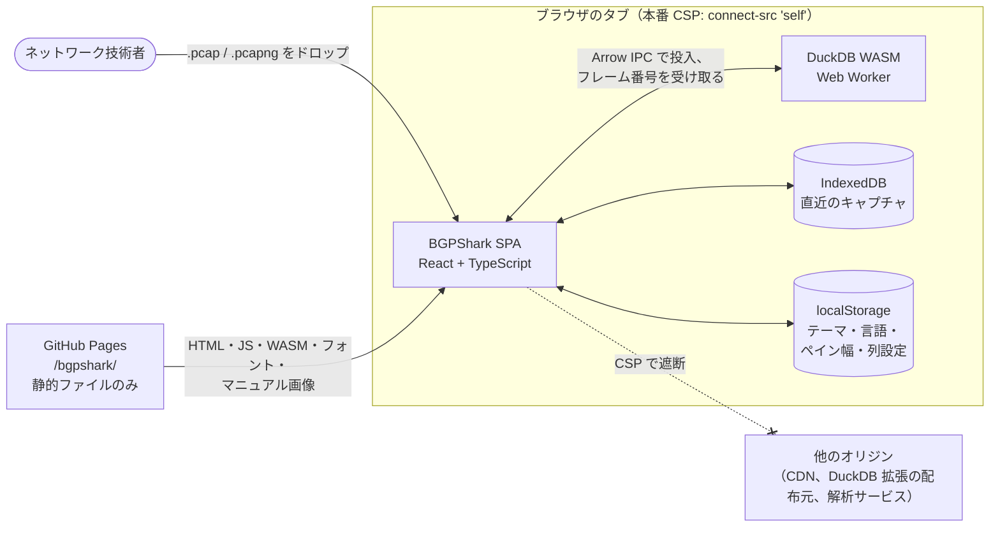

- **何もアップロードしません。** キャプチャはディスクからタブのメモリへ読み込みます。再読み込みで復元できるよう、IndexedDB にも保存します。
- **すべて自前で配信します。** DuckDB の `.wasm` とワーカー、フォント、マニュアル画像は `dist/assets/` に含めます。外部へのリクエストが 1 件でもあると `tests/e2e/offline.e2e.ts` が失敗します。
- **DuckDB はなくても動きます。** ワーカーが起動しなくても、SQL Console 以外の画面はすべて使えます（[§6](#6-読み込みとデータベースの状態) を参照）。

---

## 3. モジュールの階層

矢印は「使う側 → 使われる側」を表します。純粋な処理は `src/lib/` にあり、React に依存しません。そのため `bun test` で直接テストできます。

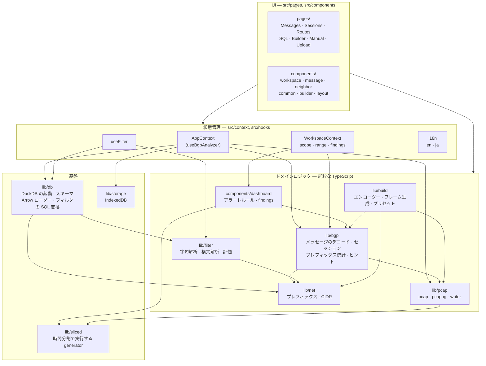

| 階層 | 担当すること | してはいけないこと |
|------|--------------|--------------------|
| UI | レイアウト、操作、URL のクエリによる画面状態（`?filter=`、`?frame=` など） | バイト列の解析や findings の計算を自分で行うこと |
| 状態管理 | 読み込んだキャプチャ、読み込みの進み具合、ワークスペースの選択セッションと時間範囲 | 導出に必要な範囲を超えて、デコード結果を複製して持つこと |
| ドメインロジック | デコード、フィルタの意味、アラートルール、キャプチャの生成 | React を読み込むこと |
| 基盤 | DuckDB、IndexedDB、時間分割の実行 | データの意味を決めること（DuckDB はフレーム番号を選ぶだけ） |

アラートルールが `src/components/dashboard/` にあるのは、以前ダッシュボード画面がルールを持っていた名残です。画面はなくなり、findings は各ビューの横に表示されるようになりました。ルール自体は今も `BgpPacket[]` を受け取るだけの関数です。

---

## 4. キャプチャの読み込み

パケット一覧をできるだけ早く表示できる順序にしています。読み取り、解析、デコードは一覧の表示前に行います。IndexedDB への保存と DuckDB への投入は、表示後に裏で行います。

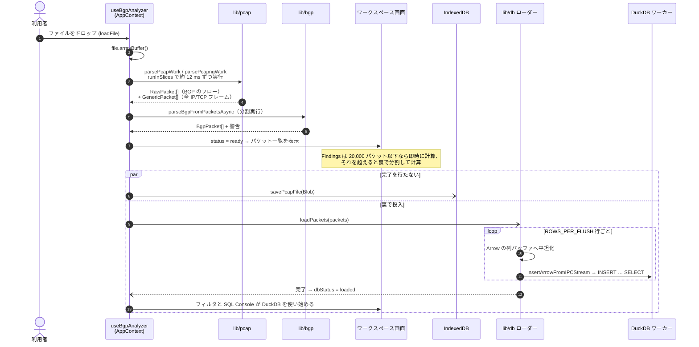

**再読み込み時**は、IndexedDB から読み戻したバッファ（`loadPcapFile`）で手順 2 から同じ処理を行います。結果が出るまで status は `initializing` です。この間 `RequireCapture` は別画面へ移動させずに待つので、ブックマークや直接リンクも再読み込み後にそのまま開けます。

**後から始まった読み込みが優先されます。** 読み込みのたびに新しい世代番号を割り当てます。古い読み込みは、新しい読み込みが始まったことに気づくと処理をやめます。DuckDB への投入も、自分の世代が表示中のときだけ進み具合を反映します。

主なファイル: `src/hooks/useBgpAnalyzer.ts`、`src/lib/sliced.ts`、`src/lib/db/loader.ts`、`src/lib/db/arrow-columns.ts`、`src/lib/storage.ts`。大きなキャプチャでの実測値は [`design.md` §3.1](design.md#31-performance) にあります。

---

## 5. デコード: フレームから BGP メッセージまで

解析器は 2 種類ありますが、出力の形は同じです。**All Packets** 表示のため、TCP フレームはすべて残します。BGP のフローに属するフレームだけが BGP のデコードへ進みます。

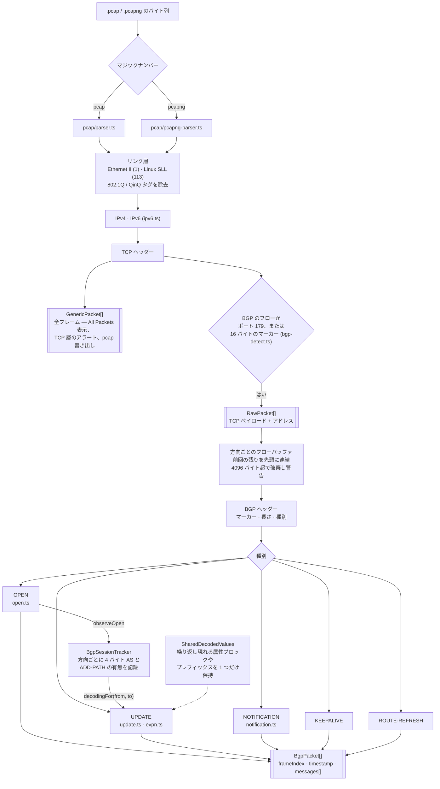

- **メッセージはそれを完成させたフレームに属します。** 複数のセグメントにまたがるメッセージは、最後のバイトを含むフレームに割り当てます。これにより `frameIndex` は単調に増え、実際のフレームと 1 対 1 に対応します。
- **セッション途中から始まるキャプチャにも対応します。** OPEN が記録されていない場合、`UpdateDecoding` は `null` になります。このとき `update.ts` は NLRI の構造から 4 バイト AS と ADD-PATH の有無を推定します（[`design.md` §2.1.7](design.md#217-update-message-analysis-srclibbgpupdatets)）。
- **共有された値は書き換えてはいけません。** 同じデコード結果を多くのメッセージが参照しています。デコード済みのメッセージは変更しないでください（`src/lib/bgp/shared-decode.ts`）。

---

## 6. 読み込みとデータベースの状態

`useBgpAnalyzer` には独立した 2 つの状態があります。`status` は分析画面を開けるかどうかを決めます。`dbStatus` はフィルタと SQL Console が DuckDB を使うかどうかを決めます。

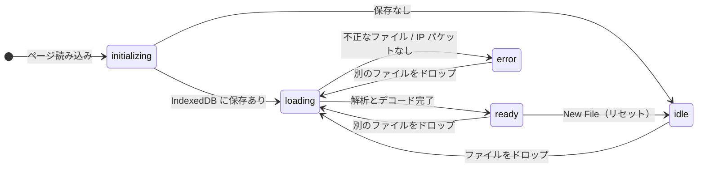

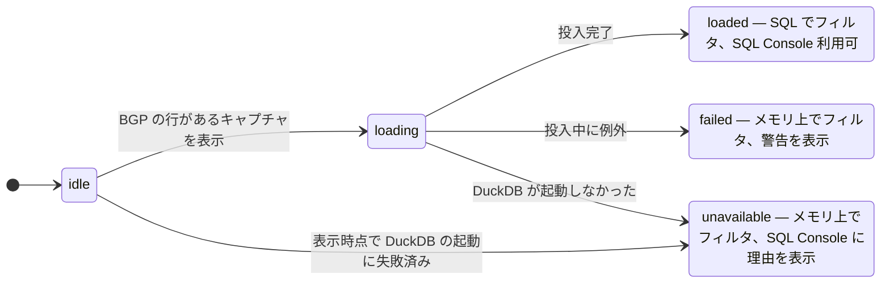

`dbStatus` は React の state として持ちます。描画のたびに `isDataLoaded()` を読むのではありません。そのため、裏での投入が終わった時点でフィルタと SQL Console が再描画されます。

---

## 7. ワークスペース: セッション・時間範囲・フィルタ

キャプチャを開くと、Messages、Sessions、Routes、SQL は 1 つのワークスペースのタブになります（`src/components/workspace/WorkspaceLayout.tsx`）。`WorkspaceContext` が決まった順序でパケットを絞り込み、各タブはその結果を読みます。

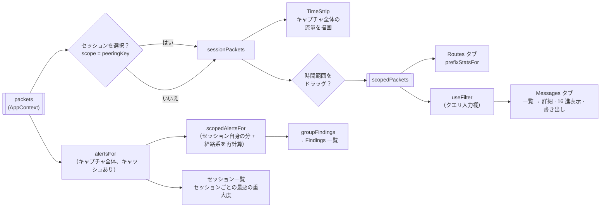

| 絞り込み | 対象 | 対象**外** |
|----------|------|------------|
| セッションの選択（scope） | Messages、Routes、Findings、Sessions の詳細 | SQL Console |
| 時間範囲 | Messages、Routes | Findings、OPEN の比較、SQL Console |
| フィルタ式 | Messages | それ以外すべて |

選択セッションと時間範囲はワークスペースのレイアウトが保持します。そのためタブを切り替えても残り、キャプチャを閉じると一緒に消えます。Finding を開いても選択セッションは変わりません。Finding のリンク自体にフィルタが含まれているためです。

---

## 8. 2 つの実行方式によるフィルタ

フィルタ式は**一度だけ**構文木に変換し、状況に合う方式で実行します。どちらの方式でも同じ結果になることが、この設計の中心となる約束です（[`CLAUDE.md`](../CLAUDE.md) を参照）。

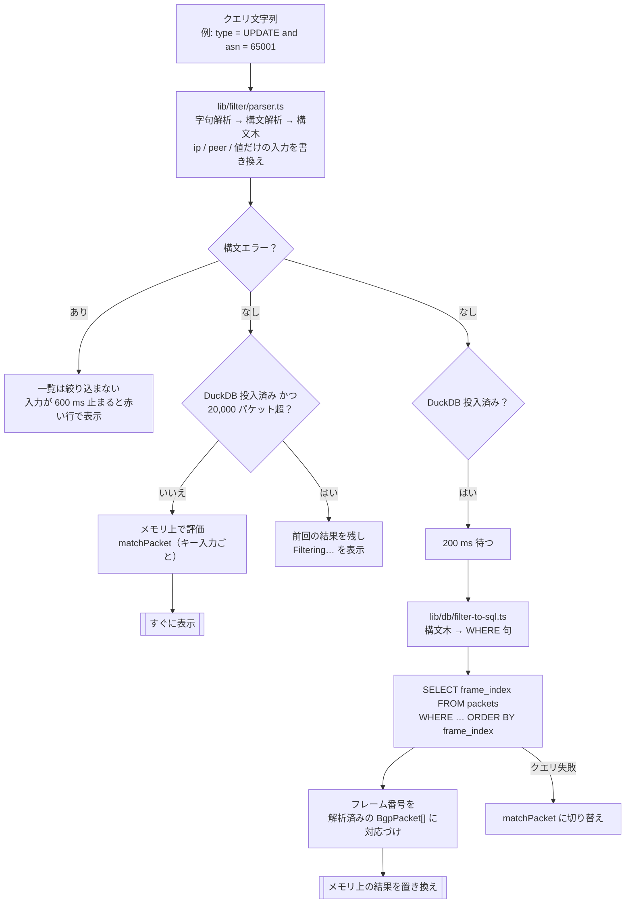

- **DuckDB は選ぶだけで、パケットを組み立て直しません。** 境界を越えるのは `frame_index` だけです。そのため、入れ子の項目が画面に届く途中で欠けることはありません（[`design-duckdb-wasm.md`](design-duckdb-wasm.md)）。
- **CIDR の照合**は、SQL 側ではビット列の列（`prefix_bits`、`src_ip_bits`）と `LIKE 'bits%'` で行います。メモリ側では `lib/net/prefix.ts` を使います。
- **既知の違い:** メモリ側の `prefix != X` は UPDATE だけに一致します。SQL 側は OPEN や KEEPALIVE も返します（`tests/e2e/prefix-matching.e2e.ts` で固定）。

---

## 9. DuckDB のテーブル

テーブルは `BgpPacket[]` を検索しやすく平坦にした写しで、`src/lib/db/schema.ts` で定義しています。どの行も `frame_index` を通じて元のフレームにたどれます。主キーはありますが、副次インデックスはありません。フレームの生バイトも保存しません。

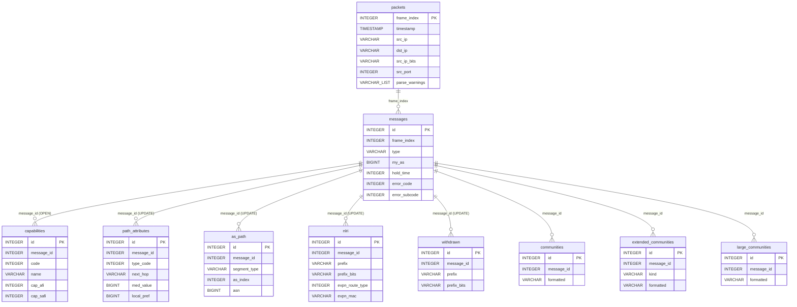

図には主な列だけを載せています。全列は SQL Console の横のスキーマ一覧で確認できます。この一覧も同じ DDL から作っています。符号なし 32 ビットの項目（ASN、MED、LOCAL_PREF）は `BIGINT` にしています。DuckDB の `INTEGER` は符号付きだからです。

**行の投入方法**（`src/lib/db/loader.ts`）: ローダーはまず全テーブルを作り直します。次にパケットを一定量ずつ Arrow の列バッファへ直接書き込みます。それを Arrow IPC のストリームに手作業で組み立て、作業用テーブルへ投入します。最後に列名を指定した `INSERT … SELECT` で本テーブルへ写します。投入は順番待ちにしており、2 つが重なることはありません。Arrow の高水準ビルダーと DuckDB の JSON 読み込み機能は使いません。本番 CSP が `new Function` と拡張機能のダウンロードを禁止しているためです。

---

## 10. Findings の算出

アラートルールは**問題 1 件ごとに 1 つ**のアラートを出します。Findings 一覧では、それを**問題の種類ごとに 1 行**へまとめます。各ルールの発火条件と、誤検知を防ぐための除外条件は [`design.md` §2.1.14](design.md#2114-alert-rules-srccomponentsdashboardalertsts) で定めています。

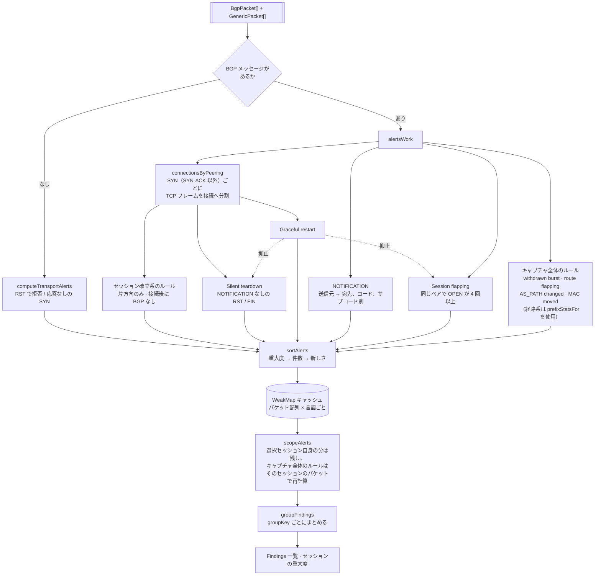

- **処理は 1 つ、実行の速さは 2 通りです。** 各ルールは generator として書いています（`src/lib/sliced.ts`）。20,000 パケット以下では `runToEnd` で一度に計算します。それを超えると `runInSlices` で約 12 ms ずつ計算し、その間も一覧を操作できます。どちらも同じコードを通るので、テストで確かめた内容が大きなキャプチャでもそのまま表示されます。
- **Graceful Restart は他のルールと連動します。** GR は他の接続系ルールと同じ `connectionsByPeering` を使います。そのため、接続の区切り方で食い違うことなく *Session flapping* と *Silent teardown* を抑止できます。
- **テスト用の題材があります。** ルールを変えたときは、`testlab/scenarios.ts` の 14 シナリオで確認してください（[`troubleshooting-scenarios.md`](troubleshooting-scenarios.md)）。

---

## 11. 画面とルーティング

`BrowserRouter` の basename は `/bgpshark` です。アップロード画面以外は `React.lazy` で必要になったときに読み込みます。

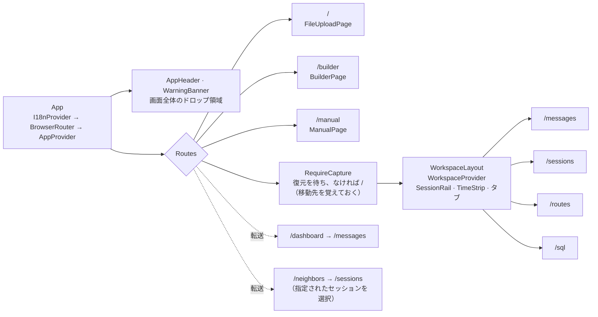

Builder とマニュアルは、意図的に `RequireCapture` の外に置いています。どちらも何も読み込んでいない段階でこそ役に立つためです。共有する価値のある画面状態は URL に持たせています（`?filter=`、`?selected=`、`?frame=`、`?all=1`、経路の検索と並び順）。リンクを開けば同じ画面を再現できます。

---

## 12. Capture Builder

Builder はブラウザ内で正しい形式のキャプチャを生成します。e2e テストの入力やシナリオ集も同じライブラリで作っています。そのため、テストが中身の見えないバイナリの pcap に頼ることはありません。

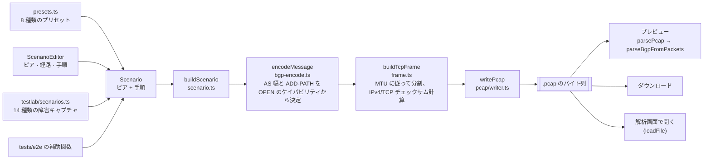

往復テスト（`tests/lib/build/round-trip.test.ts`）では、Builder で作ったものを解析器で読み戻して確かめます。これにより、生成側と解析側のずれに気づかないまま進むことを防いでいます。

---

## 13. ビルド・テスト・デプロイ

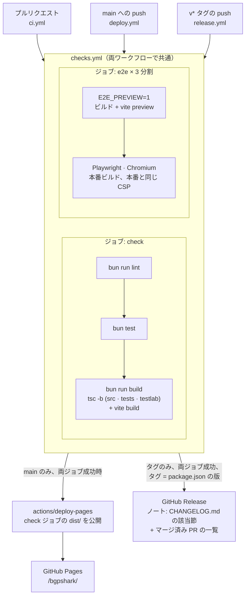

**リリース手順。** [`CHANGELOG.md`](../CHANGELOG.md) に新しい版の節を追加し、`package.json` に同じ版を設定します。main にマージしたら、そのコミットに `v<版>` のタグを push します。リリースは何もデプロイしません。サイトはすでに main の内容で公開されています。

`vite build` では `vite.config.ts` にある 4 つの独自プラグインが動きます。

| プラグイン | ビルド時のみ | 役割 |
|------------|:------------:|------|
| `markdownPlugin` | いいえ | マニュアルの `.md` を、見出し ID と画像サイズ付きの HTML に変換します。Markdown の解析器は配信物に含めません |
| `cspPlugin` | はい | `index.html` の先頭に Content Security Policy の `<meta>` を挿入します |
| `openGraphPlugin` | いいえ | リンクプレビュー用のタグを絶対 URL（`SITE_URL`）で追加します |
| `spaFallbackPlugin` | はい | `index.html` を `404.html` にコピーし、GitHub Pages でも直接リンクを開けるようにします |

CI の e2e テストは**本番ビルド**に対して実行します。開発サーバーには CSP がないためです。CSP の下でだけ壊れる変更（外部への通信や `new Function` など）は、デプロイ後ではなくこの段階で見つかります。

---

## 14. 守るべき不変条件の一覧

| 不変条件 | 担保しているもの | 影響する変更 |
|----------|------------------|--------------|
| 外部オリジンへの通信なし、`eval` / `new Function` なし | 本番 CSP、`tests/e2e/offline.e2e.ts` | 依存ライブラリ、DuckDB の機能、アセットの読み込み |
| DuckDB はフレーム番号を選ぶだけで、パケットを組み立て直さない | `lib/db/queries.ts` が公開する関数 | SQL を使う新機能 |
| フィルタの意味が 2 つの方式で一致する | `tests/lib/filter`、`tests/e2e/*filter*`、`prefix-matching.e2e.ts` | フィルタの項目や演算子の変更 |
| デコード済みのメッセージは読み取り専用 | 取り決め（`shared-decode.ts`） | `BgpPacket` に触れるすべてのコード |
| Findings は DuckDB なしで動く | ルールは `BgpPacket[]` だけを受け取る | 新しいアラートルールや集計 |
| アラートルールが仕様の表と一致する | `design.md` §2.1.14 と `testlab/scenarios.ts` | ルールの追加・変更 |
| 英語版と日本語版のマニュアルで見出しの ID が一致する | `tests/e2e/manual.e2e.ts` | マニュアルの編集 |
