# BGPShark — Architecture

English | [日本語](architecture.ja.md)

> A visual map of how BGPShark is put together: what runs where, how a capture travels from a dropped file to the screens, and which module owns which decision.
> Requirements, alert rules and performance figures live in [`design.md`](design.md); this document links there rather than repeating them.
> Diagrams are [Mermaid](https://mermaid.js.org/) and render on GitHub. When you change a flow drawn here, update the diagram in both languages.

## Contents

1. [Where to read what](#1-where-to-read-what)
2. [System context](#2-system-context)
3. [Module layers](#3-module-layers)
4. [Loading a capture](#4-loading-a-capture)
5. [Decoding: from frame to BGP message](#5-decoding-from-frame-to-bgp-message)
6. [Load and database states](#6-load-and-database-states)
7. [Workspace: scope, time window and filter](#7-workspace-scope-time-window-and-filter)
8. [Filtering on two backends](#8-filtering-on-two-backends)
9. [DuckDB tables](#9-duckdb-tables)
10. [Findings pipeline](#10-findings-pipeline)
11. [Screens and routes](#11-screens-and-routes)
12. [Capture Builder](#12-capture-builder)
13. [Build, test and deploy](#13-build-test-and-deploy)
14. [Invariants at a glance](#14-invariants-at-a-glance)

---

## 1. Where to read what

| Question | Document |
|----------|----------|
| How is it put together? Which module does what? | **This document** |
| What exactly must a feature or alert rule do? Performance targets? | [`design.md`](design.md) |
| Why DuckDB WASM, and why does it only select frame indexes? | [`design-duckdb-wasm.md`](design-duckdb-wasm.md) |
| Which BGP faults can an operator diagnose today? | [`troubleshooting-scenarios.md`](troubleshooting-scenarios.md) |
| How do I use the app? | In-app manual ([`src/pages/manual/manual.md`](../src/pages/manual/manual.md)) |
| How do I generate captures and screenshots? | [`testlab/README.md`](../testlab/README.md) |
| Rules for contributors and AI agents | [`CLAUDE.md`](../CLAUDE.md) |

---

## 2. System context

BGPShark is a static single-page app. The server only hands out files; every byte of a capture is read, decoded and queried inside the user's browser tab.

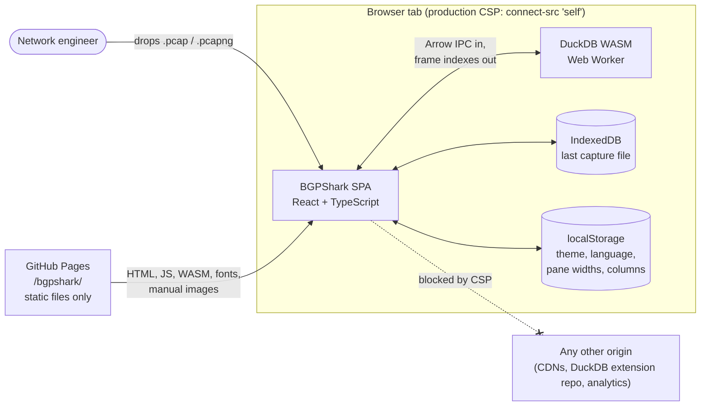

- **Nothing is uploaded.** The capture file goes from disk into the tab's memory, and into IndexedDB so a reload can restore it.
- **Everything is self-hosted.** DuckDB's `.wasm` and worker files, fonts and manual images are built into `dist/assets/`. `tests/e2e/offline.e2e.ts` fails if any request leaves the origin.
- **DuckDB is optional.** If its worker does not start, every screen except the SQL Console keeps working (see [§6](#6-load-and-database-states)).

---

## 3. Module layers

Arrows point from a module to what it uses. Pure logic sits in `src/lib/` and has no React dependency, so `bun test` can exercise it directly.

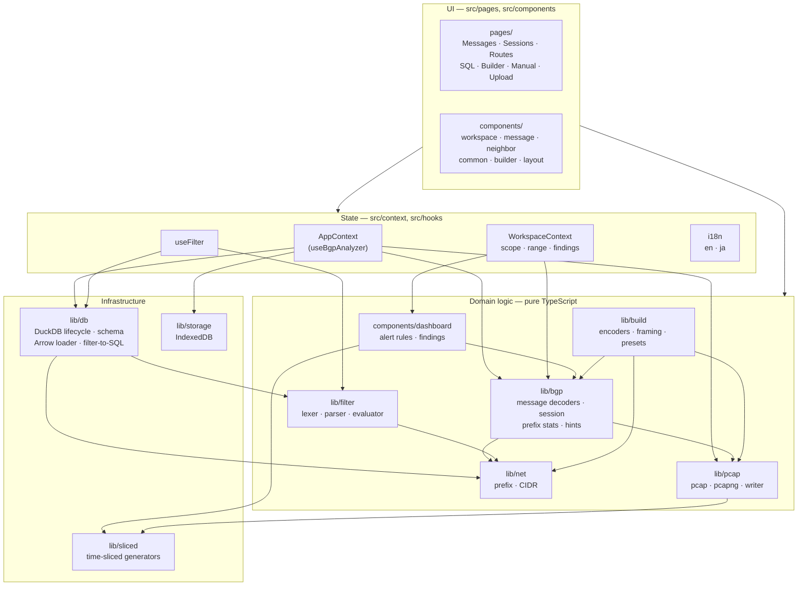

| Layer | Owns | Must not |
|-------|------|----------|
| UI | Layout, interaction, URL query state (`?filter=`, `?frame=`, …) | Parse bytes or compute findings itself |
| State | The loaded capture, load progress, the workspace's scope and window | Hold copies of decoded data beyond what it derives |
| Domain logic | Decoding, filter semantics, alert rules, capture synthesis | Import React (alert rules live under `components/dashboard/` for history, but are pure functions) |
| Infrastructure | DuckDB, IndexedDB, time slicing | Decide what data *means* — DuckDB only selects frame indexes |

The alert rules sit under `src/components/dashboard/` because the dashboard screen once owned them. The screen is gone (its findings now sit beside every view), but the rules are still plain functions over `BgpPacket[]`.

---

## 4. Loading a capture

The load is ordered so that the packet list appears as early as possible. Reading, parsing and decoding sit in front of the list; storing to IndexedDB and inserting into DuckDB happen after it, in the background.

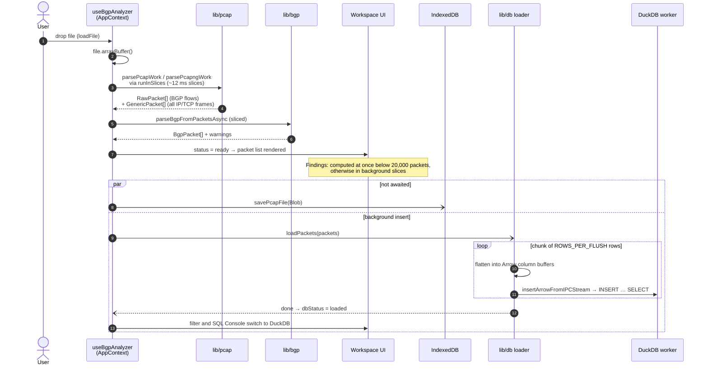

**On reload** the same path runs from step 2, with the buffer read back from IndexedDB (`loadPcapFile`). Until that answer arrives the status is `initializing`, and `RequireCapture` waits instead of redirecting, so deep links survive a reload.

**Overtaking loads.** Each load takes a new *generation* number. A slower load that notices a newer one has started stops, and a background DuckDB insert only reports progress while its generation is still on screen.

Key files: `src/hooks/useBgpAnalyzer.ts`, `src/lib/sliced.ts`, `src/lib/db/loader.ts`, `src/lib/db/arrow-columns.ts`, `src/lib/storage.ts`. Measured timings for large captures are in [`design.md` §3.1](design.md#31-performance).

---

## 5. Decoding: from frame to BGP message

Two parsers, one output shape. Every TCP frame is kept for **All Packets** mode; only frames on a BGP flow go on to the BGP decoder.

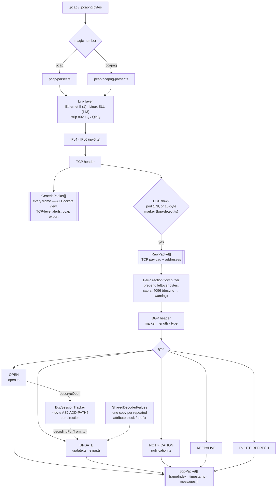

- **Frame attribution.** A message split across segments belongs to the frame that *completed* it, so `frameIndex` stays monotonic and maps 1:1 to a captured frame.
- **Mid-session captures.** When the OPENs were not captured, `UpdateDecoding` is `null` and `update.ts` infers 4-byte AS and ADD-PATH from the NLRI's structure ([`design.md` §2.1.7](design.md#217-update-message-analysis-srclibbgpupdatets)).
- **Shared values are read-only.** Many messages hold the same decoded object; nothing may mutate a decoded message (`src/lib/bgp/shared-decode.ts`).

---

## 6. Load and database states

Two independent state machines live in `useBgpAnalyzer`. `status` gates the analysis screens; `dbStatus` decides whether filtering and the SQL Console use DuckDB.

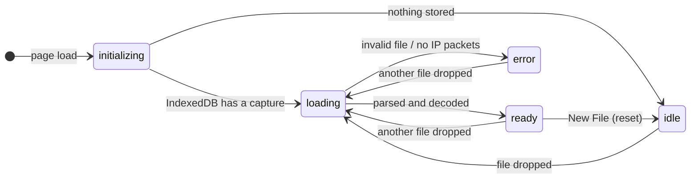

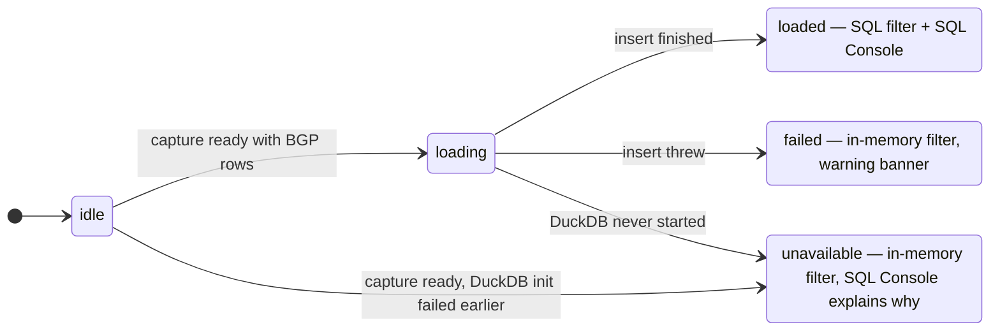

`dbStatus` is React state, not a read of `isDataLoaded()` at render time. That is what makes the filter and SQL Console re-render when the background insert lands.

---

## 7. Workspace: scope, time window and filter

Once a capture is open, Messages, Sessions, Routes and SQL are tabs of one workspace (`src/components/workspace/WorkspaceLayout.tsx`). `WorkspaceContext` narrows the packets in fixed order, and every tab reads the narrowed result.

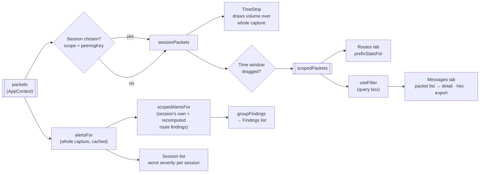

| Narrowing step | Applies to | Does **not** apply to |
|----------------|------------|-----------------------|
| Scope (chosen session) | Messages, Routes, Findings, Sessions detail | SQL Console |
| Time window | Messages, Routes | Findings, OPEN comparison, SQL Console |
| Filter expression | Messages | Everything else |

Scope and window are held by the workspace layout, so they survive tab changes and are dropped together with the capture. Opening a finding does not set the scope; its link already carries a filter.

---

## 8. Filtering on two backends

A filter expression is parsed **once** into an AST, then run on whichever backend fits. Both backends must give the same answer; this is a core invariant (see [`CLAUDE.md`](../CLAUDE.md)).

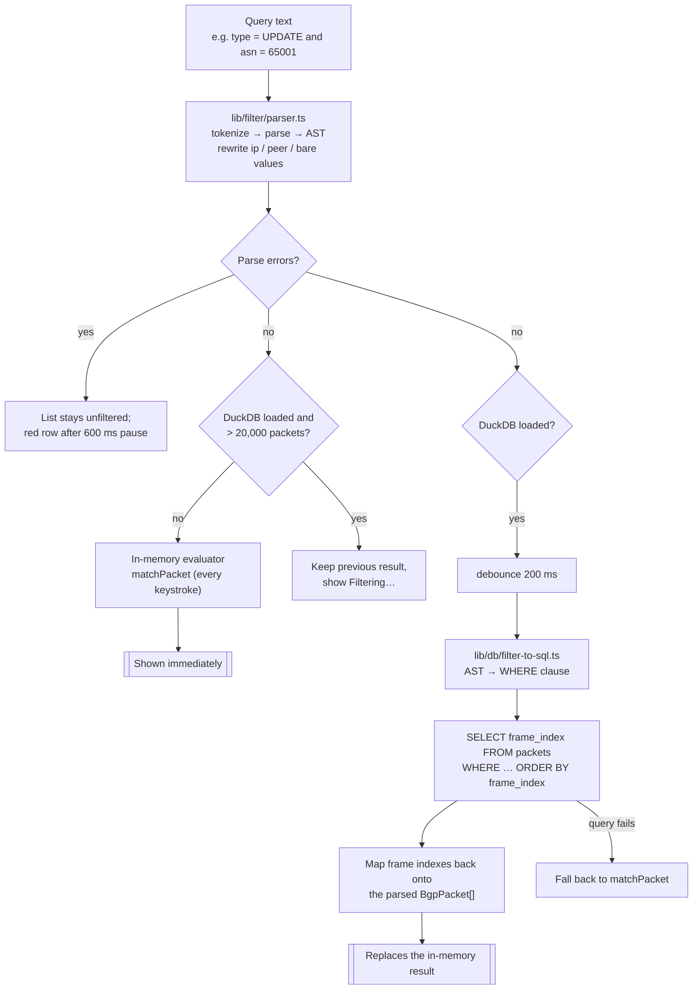

- **DuckDB selects; it never rebuilds packets.** Only `frame_index` crosses the boundary, so no nested field is lost on the way to the UI ([`design-duckdb-wasm.md`](design-duckdb-wasm.md)).
- **CIDR matching** uses bit-string columns (`prefix_bits`, `src_ip_bits`) and `LIKE 'bits%'` on the SQL side, and `lib/net/prefix.ts` in memory.
- **Known difference:** in memory, `prefix != X` matches only UPDATEs; SQL also returns OPENs and KEEPALIVEs (pinned by `tests/e2e/prefix-matching.e2e.ts`).

---

## 9. DuckDB tables

The tables are a flattened, query-friendly projection of `BgpPacket[]`, defined in `src/lib/db/schema.ts`. Every row leads back to a frame through `frame_index`. There are primary keys but no secondary indexes, and no raw frame bytes.

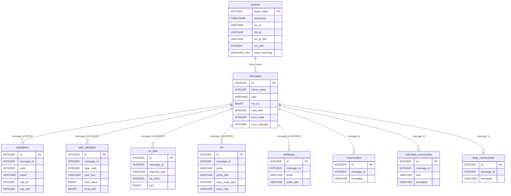

Only key columns are shown; the SQL Console's schema sidebar lists every column, read from the same DDL. Unsigned 32-bit protocol fields (ASN, MED, LOCAL_PREF) are `BIGINT`, because DuckDB's `INTEGER` is signed.

**How rows get in** (`src/lib/db/loader.ts`): the loader drops and recreates every table, then flattens packets chunk by chunk straight into Arrow column buffers, hand-assembles an Arrow IPC stream, inserts it into a staging table, and copies it over with a named-column `INSERT … SELECT`. Loads are queued so two never overlap. Arrow's high-level builders and DuckDB's JSON reader are avoided because the production CSP forbids `new Function` and remote extension downloads.

---

## 10. Findings pipeline

Alert rules report **one alert per problem instance**. The Findings list then folds instances into **one row per kind of problem**. Rule conditions and required false-positive exclusions are specified in [`design.md` §2.1.14](design.md#2114-alert-rules-srccomponentsdashboardalertsts).

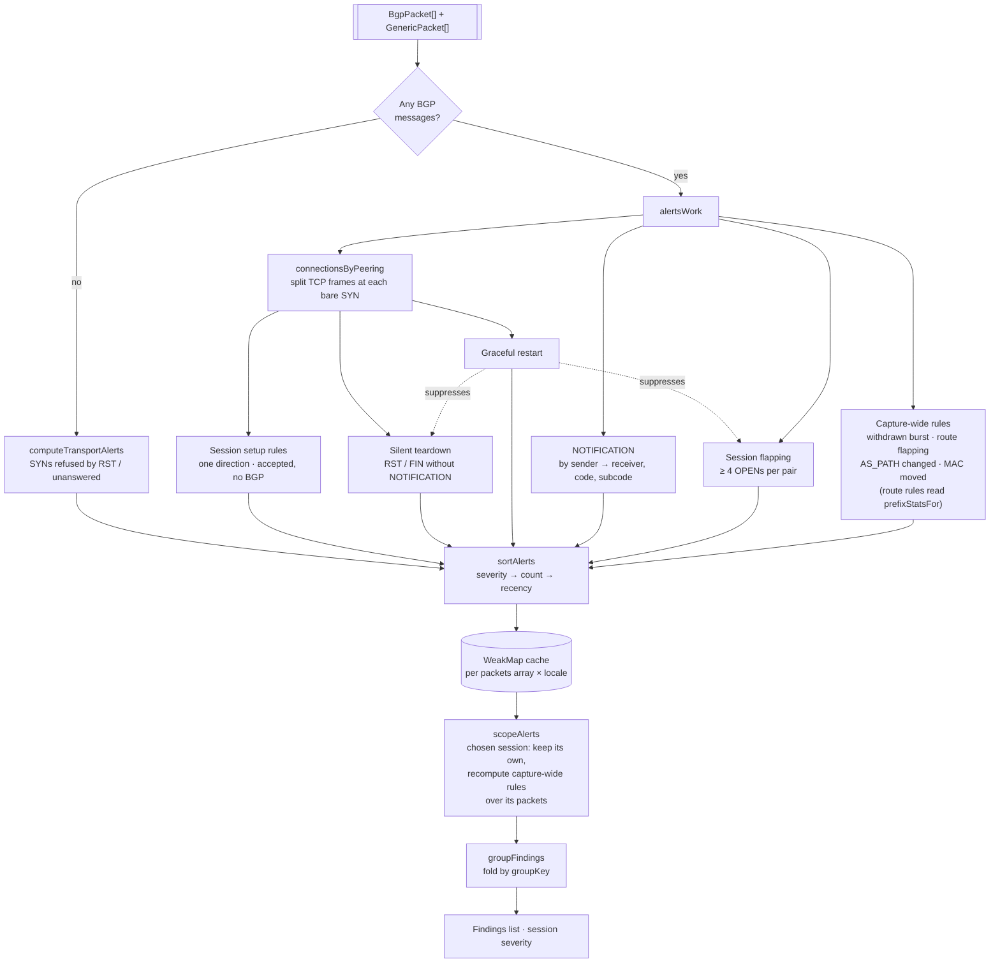

- **One body, two speeds.** Each rule is a generator (`src/lib/sliced.ts`). Below 20,000 packets `runToEnd` computes findings synchronously; above it `runInSlices` computes them in ~12 ms slices while the list stays usable. Both paths run the same code, so tests cover what large captures show.
- **Graceful Restart interlock.** GR shares `connectionsByPeering` with the other connection rules, so it can suppress *Session flapping* and *Silent teardown* without the rules disagreeing about connection boundaries.
- **Test corpus.** Rule changes are checked against the 14 scenarios in `testlab/scenarios.ts` ([`troubleshooting-scenarios.md`](troubleshooting-scenarios.md)).

---

## 11. Screens and routes

`BrowserRouter` uses basename `/bgpshark`. Every screen except the upload page is loaded on demand with `React.lazy`.

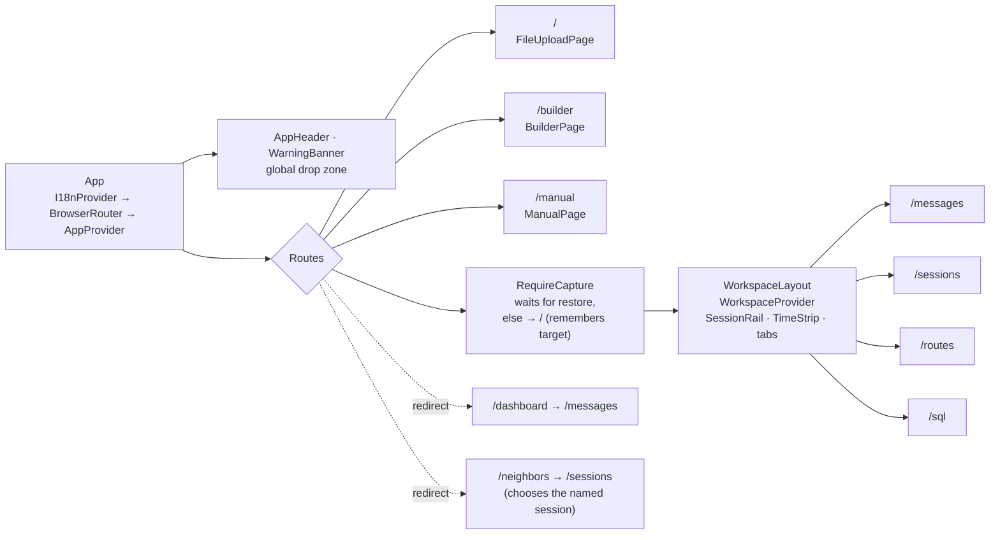

The builder and manual sit outside `RequireCapture` on purpose: they are most useful before anything is loaded. Screen state that is worth sharing lives in the URL (`?filter=`, `?selected=`, `?frame=`, `?all=1`, route search and sort), so a link reproduces the view.

---

## 12. Capture Builder

The builder synthesizes valid captures in the browser. The same library generates the e2e fixtures and the scenario corpus, so tests never depend on opaque binary pcaps.

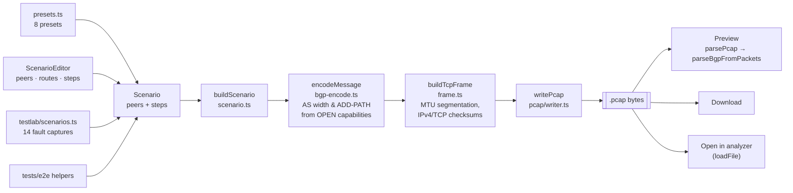

Round-trip tests (`tests/lib/build/round-trip.test.ts`) encode with the builder and decode with the parser, so the two cannot drift apart silently.

---

## 13. Build, test and deploy

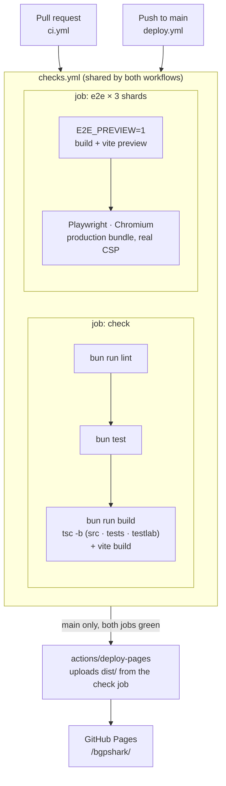

`vite build` runs four project plugins from `vite.config.ts`:

| Plugin | Build-only | What it does |
|--------|:----------:|--------------|
| `markdownPlugin` | no | Converts the manual's `.md` files to HTML with heading IDs and figure sizes, so no Markdown parser ships |
| `cspPlugin` | yes | Prepends the Content Security Policy `<meta>` to `index.html` |
| `openGraphPlugin` | no | Adds link-preview tags with absolute URLs (`SITE_URL`) |
| `spaFallbackPlugin` | yes | Copies `index.html` to `404.html`, so deep links work on GitHub Pages |

The e2e suite runs against the **production build** in CI, because the dev server ships no CSP. A change that only breaks under CSP (a remote fetch, `new Function`) is caught there, not after deploy.

---

## 14. Invariants at a glance

| Invariant | Enforced by | Where it matters |
|-----------|-------------|------------------|
| No off-origin requests, no `eval` / `new Function` | Production CSP, `tests/e2e/offline.e2e.ts` | Dependencies, DuckDB features, asset loading |
| DuckDB selects frame indexes; it never rebuilds packets | `lib/db/queries.ts` API surface | Any new SQL-backed feature |
| Filter semantics match on both backends | `tests/lib/filter`, `tests/e2e/*filter*`, `prefix-matching.e2e.ts` | Any change to filter fields or operators |
| Decoded messages are read-only | Convention (`shared-decode.ts`) | Any code that touches `BgpPacket` |
| Findings work without DuckDB | Rules take `BgpPacket[]` only | New alert rules and aggregations |
| Alert rules match the spec table | `design.md` §2.1.14 + `testlab/scenarios.ts` | Adding or changing a rule |
| EN / JA manual headings share anchor IDs | `tests/e2e/manual.e2e.ts` | Editing the manual |
