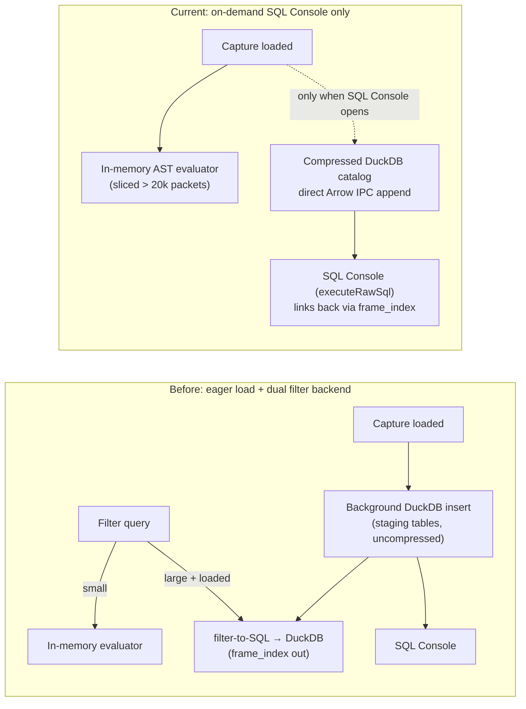

# DuckDB WASM — Architecture Decision Record

> Records why DuckDB WASM was adopted, how the shipped implementation diverged from the initial proposal, and the trade-offs accepted.
> For the current architecture, see [`design.md` §4.3](design.md#43-data-flow). The authoritative schema is [`src/lib/db/schema.ts`](../src/lib/db/schema.ts).

## Why an in-browser database

Earlier revisions held parsed packets in React state and filtered them with a linear array scan. That broke down in four ways:

1. **Scale:** Captures beyond ~100,000 packets became sluggish.
2. **Filtering:** Unindexed full-array scans on every filter edit.
3. **Extensibility:** Every new query shape required extending a custom evaluator.
4. **Ad-hoc analysis:** Cross-prefix and AS_PATH aggregations were awkward to express without a query language.

DuckDB WASM provides columnar in-browser storage and full SQL with no server component, fitting BGPShark's aggregate- and filter-heavy queries while keeping everything client-side.

## Proposal vs. implementation

| Topic | Initial proposal | Shipped implementation |
|-------|------------------|------------------------|
| Bundle delivery | jsDelivr CDN | Self-hosted in `dist/assets/` via Vite `?url` imports to comply with CSP |
| Query API | `getPackets`, `getNeighborSummary`, `getAsPathStats`, `getPrefixStats` | One entry point, `executeRawSql`, for the SQL Console |
| Filtering | Reconstruct `BgpPacket` objects from SQL rows | In memory only; DuckDB used to select frame indexes for large captures (see *Revision* below) |
| Aggregation views | Compute in DuckDB | Compute in memory (`useMemo`) so screens stay functional if DuckDB fails |
| React integration | Dedicated `useDuckDB` hook | Folded into `useBgpAnalyzer` (`requestDatabase`, called by the SQL Console) |
| CIDR matching | PostgreSQL `inet` operators | Bit-string columns (`prefix_bits`) with `LIKE 'bits%'`, still available to SQL queries |
| Row ingestion | Per-row prepared statements | Arrow IPC appended to each table, columns in schema order; repeated text dictionary-encoded |
| Storage | Default in-memory database | Attached in-memory catalog with compression (`ATTACH ':memory:' AS capture (COMPRESS)`), no primary keys |

### Key lessons

- **Link back, do not reconstitute:** The SQL tables are a flattened projection that cannot losslessly represent every nested capability or attribute. Originally, returning only `frameIndex` values prevented data loss when DuckDB backed filtering; today the same rule applies to the SQL Console—SQL results link back to the parsed `BgpPacket[]` through `frame_index` rather than rebuilding packets from rows (`design.md` §4.3).
- **CSP applies to database features, not just static assets:**
  - Loading via `read_json_auto` failed in production because DuckDB's JSON reader is a dynamically downloaded extension blocked by `connect-src 'self'`.
  - Loading via literal `VALUES` avoided the network but spent ~0.1 ms per row parsing SQL (nearly 2 minutes for an 18 MB / 1.6M-row capture).
  - Loading via built-in **Arrow IPC** (`insertArrowFromIPCStream`) requires no extension and loads the same capture in a few seconds. Arrow buffers are assembled manually because `apache-arrow`'s high-level builders use `new Function`, which the production CSP's `script-src` forbids. Batches are appended to their tables directly; the append binds columns by position, so `src/lib/db/load-batches.ts` lists them in schema order, checked at load and by a unit test. (A staging table and named-column `INSERT ... SELECT` used to do that binding, at the cost of writing every row twice.)
- **An uncompressed in-memory database does not fit a dense capture:** 22 million announced routes needed more than the worker's 3.1 GB and failed the load. Compressed and without primary-key indexes, the same tables take 139 MB.

## Revision: DuckDB serves only the SQL Console

Large captures used to be filtered by SQL once their packets had been inserted, which happened in the background after every load. Measured on synthetic ~95 MB captures, that insert held the main thread for several seconds while the findings were being worked out beside it, and it failed outright on the dense capture above; meanwhile one in-memory filter pass over 100 MB takes 0.1–0.7 s, and runs in slices. So filtering was moved entirely into memory (`useFilter`), the filter-to-SQL compiler was removed, and DuckDB is started and filled only when the SQL Console is opened. That also ended the dual-backend rule that every filter change had to be made twice, and a known difference between the two backends on negation.

## Trade-offs accepted

**Benefits:** Built-in query planning and ad-hoc SQL over the whole capture without maintaining custom query syntax.

**Costs:**
1. **Bundle size & load time:** Self-hosting adds two WASM bundles (`mvp` and `eh`) to `dist/`; browsers download only one, and only once the SQL Console is opened.
2. **Memory overhead:** DuckDB holds compressed table copies alongside the in-memory `BgpPacket[]`, once the SQL Console has asked for them.
3. **JS/SQL boundary conversion** and harder query debugging compared to plain predicates.
4. **Possible initialization failure:** Only the SQL Console depends on DuckDB, so only it is lost; it retries when reopened.

## Alternatives rejected

- **IndexedDB with custom indexes:** Lighter footprint, but requires building and maintaining a custom query engine.
- **sql.js (SQLite WASM):** Smaller binary, but row-oriented and poorly suited to aggregate-heavy analytical queries.
- **Web Workers with linear scans:** Improves UI responsiveness without improving algorithmic scale or ad-hoc querying.
